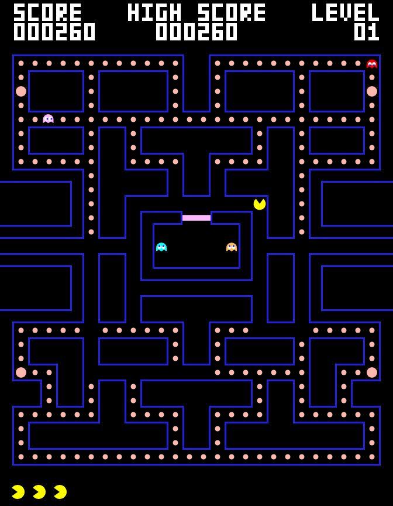
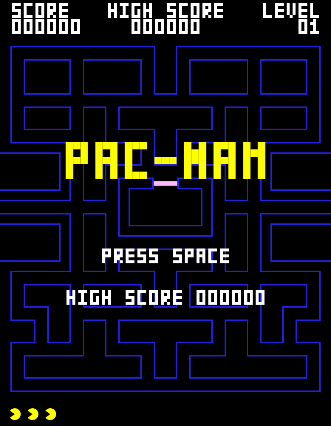

# PacMan

[](https://github.com/gerrcass/pacman-lab/actions/workflows/ci.yml)
[](https://github.com/gerrcass/pacman-lab/actions/workflows/deploy.yml)

A browser remake of the arcade game Pac-Man. PacMan eats Pellets through the
Maze while four Ghosts hunt him, and a Power Pellet flips the hunt. It is built
with TypeScript and Vite on the Canvas 2D API, over a deterministic simulation
core that reproduces a game from a seed plus an input sequence.

**Play it: <https://gerrcass.github.io/pacman-lab/>**



## What this is

Two things at once:

- **The game.** A single-screen, arcade-faithful PacMan slice: the classic
  Maze, four Ghosts running the original Scatter/Chase/Frightened AI, Pellets,
  Power Pellets, Fruit, Lives, Levels, and the arcade's screens, all drawn in
  one pixel style.
- **The testbed.** A hobby and educational repo used to try out a four-beat
  agent workflow: isolate, build, prove, ship. The workflow is the point as
  much as the game.

## Play

Open <https://gerrcass.github.io/pacman-lab/> in a browser, or run it locally
(below).

| Action           | Input                     |
| ---------------- | ------------------------- |
| Move             | Arrow keys or WASD        |
| Start / restart  | Space or Enter            |
| Pause            | P or Escape               |
| Mute             | M                         |
| CRT filter       | C                         |

On a touch device, swipe to steer or drag the on-screen d-pad, and tap to
start.

The game opens on a title screen and shows a READY prompt before each Level.
Eating a Power Pellet turns the Ghosts Frightened, each Ghost eaten while
Frightened doubles in value, and an eaten Ghost returns to the house as a pair
of eyes. Clearing every Pellet advances the Level and speeds everyone up. The
run ends with a death animation and a game over screen you can restart from,
and the high score survives a reload.



## Run it locally

Node 22+ and npm 11 are required.

```bash
npm install
npm run dev      # serves the game at http://localhost:5173
```

`npm run dev` serves with hot reload. For a production build:

```bash
npm run build    # tsc --noEmit, then vite build -> dist/
npm run preview  # serve dist/ locally
```

The build is host-agnostic static output (ADR-0003). To build for a sub-path,
set `BASE_PATH`:

```bash
BASE_PATH=/pacman-lab/ npm run build
```

## The workflow

Every task moves through four beats, each backed by a skill in `.agents/skills/`
and tied together by [`AGENTS.md`](./AGENTS.md):

| Beat    | Skill                              | What it does                                                    |
| ------- | ---------------------------------- | --------------------------------------------------------------- |
| Isolate | `/new-feature`                     | Fresh Git worktree and branch from `origin/main`, one per task  |
| Build   | `/code-structure`                  | Actions orchestrate the why and when; a service owns the how    |
| Prove   | `/evidence-driven-testing`         | Repo checks plus recorded before/after evidence                 |
| Ship    | `/before-and-after`, `/greploop`   | A PR with before/after proof, iterated until review passes      |

`/unslop` runs over anything a person reads: commits, PR bodies, docs, replies.

### The slice: issue #1

The whole game was scoped as one spec, [issue #1][spec], titled "PacMan
vertical slice". That issue is a container: it holds the problem, the 60 user
stories, the architecture decisions, and the testing plan. It is the sprint
goal for everything else, and no code is written directly for it.

`/to-tickets` split the spec into thirteen implementation tickets, published as
sub-issues with blocking edges between them:

| #                                              | Ticket                                          |
| ---------------------------------------------- | ----------------------------------------------- |
| [#3](https://github.com/gerrcass/pacman-lab/issues/3)   | Scaffold, checks, and static build     |
| [#4](https://github.com/gerrcass/pacman-lab/issues/4)   | Deterministic core and PacMan movement |
| [#5](https://github.com/gerrcass/pacman-lab/issues/5)   | Deploy the static build to Pages       |
| [#6](https://github.com/gerrcass/pacman-lab/issues/6)   | Pellets, Power Pellets, score, HUD     |
| [#7](https://github.com/gerrcass/pacman-lab/issues/7)   | Four Ghosts and their AI               |
| [#8](https://github.com/gerrcass/pacman-lab/issues/8)   | Frightened: the Power Pellet flip      |
| [#9](https://github.com/gerrcass/pacman-lab/issues/9)   | Lives, death, and game over            |
| [#10](https://github.com/gerrcass/pacman-lab/issues/10) | Game states and screens                |
| [#11](https://github.com/gerrcass/pacman-lab/issues/11) | Fruit bonus                            |
| [#12](https://github.com/gerrcass/pacman-lab/issues/12) | Audio: procedural SFX and mute         |
| [#13](https://github.com/gerrcass/pacman-lab/issues/13) | Touch controls                         |
| [#14](https://github.com/gerrcass/pacman-lab/issues/14) | Polish: particles, shake, CRT filter   |
| [#15](https://github.com/gerrcass/pacman-lab/issues/15) | Slice verification and evidence        |

The container and its tickets are a sprint and its to-do list. Each ticket
starts blocked or ready, and closes when its PR merges. The open tickets that
are ready, unblocked, and unassigned are the **frontier**, the queue the
workflow works through. A fresh session runs `/next-ticket` to take the first
ticket in the frontier through all four beats to an open PR, then stops. Repeat
until the frontier is empty and the slice is done.

The build order followed the tickets, from the scaffold and checks through the
core, the Ghosts, and the polish, and closed with a verification pass that
recorded video of the finished game.

The full harness, the checks and gates, and how a ticket flows end to end are in
[docs/agents/workflow.md](./docs/agents/workflow.md).

## How it's built

The design is settled in the ADRs and the spec:

- A pure, deterministic simulation core with no DOM and no Canvas imports,
  running on a fixed 60 Hz timestep with a seeded RNG (ADR-0001). The same seed
  and intent sequence produce the same game, so a state is reproducible.
- A render layer that reads a read-only snapshot each frame and interpolates
  between ticks.
- An orchestration layer that maps raw input to intents and drives the game
  states.

The simulation sits behind a single seam: create a simulation from a config and
a seed, advance it one fixed tick at a time, and read a snapshot. The tests
drive that seam and assert on outcomes, never on internals.

The code is four deep modules under `src/packages/`, each reachable only through
its entry point (see [src/packages/README.md](./src/packages/README.md)):

| Package  | Role                                                       |
| -------- | ---------------------------------------------------------- |
| `core`   | The pure, deterministic simulation (ADR-0001)              |
| `render` | Canvas 2D rendering                                        |
| `app`    | Orchestration: the canvas, the frame loop, and game states |
| `audio`  | Procedural Web Audio SFX with a mute switch                |

`npm run deps` (dependency-cruiser) enforces the boundaries, and ESLint bans DOM
globals inside `core`.

## Checks

Five commands, all run from the repo root:

| Command           | Tool               | Covers                                      |
| ----------------- | ------------------ | ------------------------------------------- |
| `npm run typecheck` | `tsc --noEmit`   | TypeScript types                            |
| `npm run lint`    | ESLint + Prettier  | style, and core purity                      |
| `npm test`        | Vitest             | the simulation and render unit tests        |
| `npm run deps`    | dependency-cruiser | deep-module boundaries and the ADR-0001 seam |
| `npm run build`   | `tsc` + Vite       | the production bundle in `dist/`            |

CI runs them on every pull request
([.github/workflows/ci.yml](./.github/workflows/ci.yml)), and a push to `main`
deploys `dist/` to GitHub Pages
([.github/workflows/deploy.yml](./.github/workflows/deploy.yml)).

## Docs

- [GLOSSARY.md](./GLOSSARY.md): the domain vocabulary.
- [docs/adr/](./docs/adr/): the architecture decision records.
- [docs/agents/workflow.md](./docs/agents/workflow.md): the workflow in depth.
- [src/packages/README.md](./src/packages/README.md): the package rules.
- [AGENTS.md](./AGENTS.md): the rules an agent loads on every turn.

## Skills

Skills come from three upstream collections, pinned in `skills-lock.json`:

- [`michaelshimeles/skills`](https://github.com/michaelshimeles/skills):
  `new-feature`, `code-structure`, `evidence-driven-testing`, `greploop`,
  `greploop-apps`, `before-and-after`, `unslop`.
- [`mattpocock/skills`](https://github.com/mattpocock/skills): `grilling`,
  `domain-modeling`, `to-spec`, `to-tickets`, `triage`, `code-review`, and the
  rest of the engineering and productivity set.
- [`vercel-labs/skills`](https://github.com/vercel-labs/skills): `find-skills`.
- Repo-local: `next-ticket`, the per-ticket runner that composes the four beats.

Install or refresh the vendored skills with `npx skills add` once per source:
`michaelshimeles/skills`, `mattpocock/skills`, and `vercel-labs/skills`.

## Layout

```
AGENTS.md                 workflow + repo-specific callouts
skills-lock.json          pinned skill sources and hashes
.agents/skills/           installed skills
.agents/skills/next-ticket/  repo-local per-ticket runner
.github/workflows/        ci.yml (PR checks), deploy.yml (Pages)
docs/adr/                 architecture decision records (0001-0004)
docs/agents/              workflow architecture, tracker, evidence, learnings
docs/images/              README screenshots
GLOSSARY.md               domain vocabulary
index.html                the app entry
src/packages/             deep modules; each hides its implementation in lib/
  core/                   pure, deterministic simulation (ADR-0001)
  render/                 Canvas 2D rendering
  app/                    orchestration and the frame loop
  audio/                  procedural Web Audio SFX
tools/pw.sh               runs a Playwright capture script
tools/capture.mjs         reusable evidence-capture helpers
.worktrees/               per-task git worktrees (gitignored)
.artifacts/               evidence captures (gitignored)
```

[spec]: https://github.com/gerrcass/pacman-lab/issues/1
